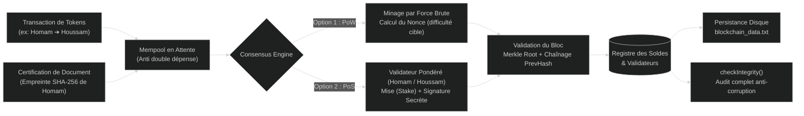

# ⛓️ Blockchain-Core-CPP

<p align="center">
  <a href="https://homam-dany.github.io/Blockchain-Core-CPP/index.html">
    
  </a>
  <a href="https://github.com/Homam-Dany/Blockchain-Core-CPP">
    
  </a>
</p>

<p align="center">
  
  
  
  
  
</p>

---

Moteur blockchain autonome, ultra-léger et haute performance implémenté intégralement **from scratch en C++** (zéro dépendance externe, sans OpenSSL).

Ce projet intègre les fondamentaux cryptographiques et d'architecture distribuée : **moteur SHA-256 natif**, **arbre de Merkle récursif**, **consensus hybride Proof of Work (PoW) et Proof of Stake (PoS)**, **audit de sécurité anti-cyberattaques**, **certification et horodatage de documents**, et **persistance automatique sur fichier**.

---

## 🎨 Résumé Visuel & Infographie Complète

> 💡 **Dashboard Interactif en Ligne :** Vous pouvez tester en direct la simulation des cyberattaques et comparer le PoW et PoS sur **[homam-dany.github.io/Blockchain-Core-CPP/index.html](https://homam-dany.github.io/Blockchain-Core-CPP/index.html)**.

<p align="center">
  <a href="https://homam-dany.github.io/Blockchain-Core-CPP/index.html">
    
  </a>
</p>

---

## 🏗️ Architecture Globale & Flux de Données

Le flux complet ci-dessous illustre le parcours d'une transaction ou d'un document certifié, depuis sa soumission jusqu'à son enregistrement immuable sur disque :



---

## 🌟 Piliers Techniques du Projet

### 1. 🔐 Fondation Cryptographique (From Scratch)
- **Moteur SHA-256 natif** :
  - Développé de zéro en C++ sans bibliothèque tierce.
  - Découpage et remplissage (padding) des messages par blocs de **512 bits**.
  - Cycle de compression sur **64 tours** utilisant les constantes standard $K$.
  - Génération d'une empreinte cryptographique irréversible de **256 bits** (64 caractères hexadécimaux).
- **Arbre de Merkle hiérarchique** :
  - Calcul récursif de la racine de Merkle (`merkleRoot`) par hachage deux à deux des transactions d'un bloc.
  - Permet une vérification instantanée de l'intégrité : la moindre altération d'un caractère dans une transaction passée modifie la racine de Merkle et invalide le bloc.
- **Anatomie complète d'un bloc** :
  - `Index` : Position ordonnée dans la chaîne.
  - `Timestamp` : Horodatage exact de création.
  - `PrevHash` : Hash du bloc précédent (chaînage cryptographique inviolable).
  - `MerkleRoot` : Condensé de toutes les transactions du bloc.
  - `Nonce` : Preuve de calcul en Proof of Work.
  - `Validator` & `Signature` : Preuve d'autorité et signature secrète en Proof of Stake.
  - `Hash` : Empreinte SHA-256 du bloc calculée à partir de son en-tête.
  - **Bloc Genesis (#0)** : Bloc fondateur initialisé automatiquement comme ancre de confiance immuable.

---

### 2. ⚡ Double Consensus Hybride : PoW vs PoS

L'application permet d'expérimenter et de comparer en temps réel les deux grands mécanismes de consensus :

| Caractéristique | ⛏️ Proof of Work (PoW) | ◈ Proof of Stake (PoS) |
| :--- | :--- | :--- |
| **Mécanisme** | Résolution d'une énigme mathématique par force brute (recherche du `Nonce`). | Sélection pseudo-aléatoire pondérée par la mise financière (`Stake`). |
| **Condition de validation** | `Hash` commençant par $N$ zéros (difficulté configurable, ex: `000...`). | Signature cryptographique générée par la clé secrète du validateur tiré. |
| **Validateurs par défaut** | Puissance de calcul brute. | **Homam** (Mise : 50.0), **Houssam** (Mise : 30.0). |
| **Temps de création** | Proportionnel à la difficulté (mesuré en millisecondes). | Quasi instantané (< 0.1 ms). |
| **Consommation énergétique** | Élevée (charge CPU intensive). | Négligeable (vert et écologique). |
| **Récompense de bloc** | Validation du bloc miné. | Incrément de mise (+1 token attribué au validateur). |

---

### 3. 🛡️ Audit de Sécurité & Détection des Cyberattaques

La méthode `checkIntegrity()` effectue un audit systématique de toute la chaîne et identifie précisément la nature et l'emplacement de toute fraude :

1. **Altération de transaction** : La racine de Merkle recalculée $\neq$ `merkleRoot` stockée dans l'en-tête du bloc.
2. **Rupture de chaînage** : Le `prevHash` du bloc $N$ ne correspond pas au `hash` du bloc $N-1$.
3. **Falsification d'en-tête (Header)** : Le hash stocké du bloc $\neq$ `SHA256(headerData)`.
4. **Falsification de difficulté PoW** : Le hash ne satisfait pas la difficulté requise (préfixe de zéros manquant).

---

### 4. 💼 Fonctionnalités Métier
- **Registre des comptes & Anti-Double Dépense** :  
  Vérification en temps réel du solde disponible en déduisant les transferts déjà placés dans le pool en attente (`Mempool`).
- **Certification & Horodatage de Documents** :  
  Preuve d'existence et d'intégrité de fichiers, contrats ou diplômes par ancrage de leur empreinte SHA-256 associée au nom du propriétaire (**Homam**), sans stocker le document en clair sur la chaîne.
- **Persistance Disque Automatique** :  
  Sauvegarde et restauration automatique de l'état complet de la blockchain et des soldes dans le fichier indexé `blockchain_data.txt`.

---

## 🎮 Démonstration du Menu Interactif (CLI)

Au lancement de l'application, un menu interactif permet d'effectuer toutes les opérations :

```text
================================================================
        BIENVENUE DANS VOTRE LOGICIEL BLOCKCHAIN (C++)          
================================================================
------------------------- MENU PRINCIPAL -------------------------
  1. [Transaction]   Envoyer des tokens (ex: Homam -> Houssam)
  2. [Certification] Horodater et certifier un document / texte
  3. [Minage]        Valider les transactions en attente (PoW ou PoS)
  4. [Comptes]       Voir les soldes et validateurs
  5. [Historique]    Afficher tous les blocs de la blockchain
  6. [Securite]      Verifier l'integrite de la blockchain
  7. [Compte]        Creer un nouvel utilisateur
  8. [Sauvegarder]   Enregistrer la blockchain dans un fichier
  9. [Recharger]     Recharger la blockchain depuis le fichier
  0. [Quitter]       Sauvegarder et quitter le programme
------------------------------------------------------------------
```

### Exemple de Scénario Réel :

#### 1. Transfert de jetons :
```text
-- Envoyer des tokens --
Nom de l'expediteur : Homam
Nom du destinataire : Houssam
Montant en tokens   : 25.50
  [OK] Transaction ajoutee dans le pool en attente.
```

#### 2. Certification d'un document confidentiel :
```text
-- Certifier un document / texte --
Proprietaire du document        : Homam
Titre / Description du document : Contrat_Partenariat_Officiel.pdf
Texte ou contenu a certifier    : Engagement confidentiel signe entre Homam et Houssam
Empreinte SHA-256 calculee      : 8a7f1c93e4d5b2a1...
  [OK] Document certifie en attente de validation dans le prochain bloc.
```

#### 3. Validation par Proof of Stake (PoS) :
```text
-- Choisir le mecanisme de consensus --
1. Proof of Work (Minage avec difficulte 3)
2. Proof of Stake (Validation ponderee par mise)
Votre choix (1 ou 2) : 2
  [SUCCES PoS] Bloc forge instantanement par le validateur : Homam (Mise actuelle: 51.0)
  [BLOCKCHAIN] Bloc #1 valide et enregistre dans la chaine !
  Hash : 000a4f89d31c...
```

#### 4. Audit d'intégrité :
```text
  [INTEGRITE] 100% VALIDE - Tous les 2 blocs sont intacts et inviolables.
```

---

## 🚀 Compilation & Exécution

### 📋 Prérequis
- Un compilateur C++ supportant **C++11** ou supérieur (`g++`, `clang++`, ou `MSVC`).

### 🔨 Compilation
```bash
# Cloner le dépôt
git clone https://github.com/Homam-Dany/Blockchain-Core-CPP.git
cd Blockchain-Core-CPP

# Compiler avec optimisations
g++ -std=c++17 -O2 main.cpp -o blockchain_core.exe
```

### ▶️ Lancement
```bash
# Sur Windows :
.\blockchain_core.exe

# Sur Linux / macOS :
./blockchain_core
```

---

## 📂 Structure du Répertoire

```text
Blockchain-Core-CPP/
├── docs/                                       # Dossier dédié aux ressources web & visuelles
│   ├── index.html                              # Dashboard web interactif en direct (GitHub Pages)
│   └── infographie_blockchain_blanc.png        # Infographie de synthèse haute définition
├── main.cpp                                    # Cœur C++ complet (SHA-256, Merkle, PoW, PoS, CLI)
└── README.md                                   # Documentation officielle du projet
```

---

## 👤 Auteur & Projet

- **Auteur principal** : **Homam Dany** ([@Homam-Dany](https://github.com/Homam-Dany))
- **Projet** : Atelier Sécurité & Éthique des Données — Implémentation complète d'un cœur Blockchain.
