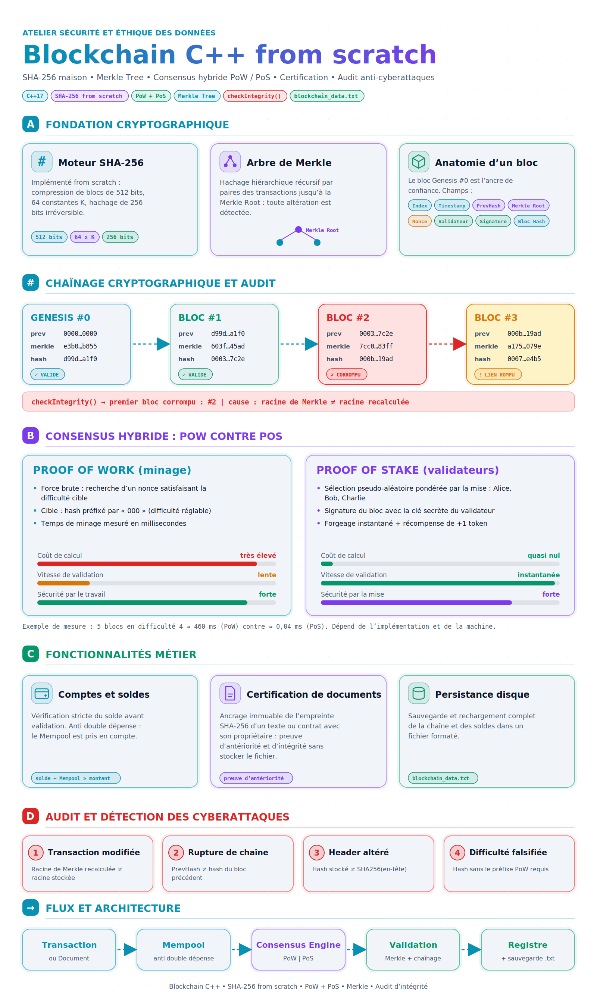
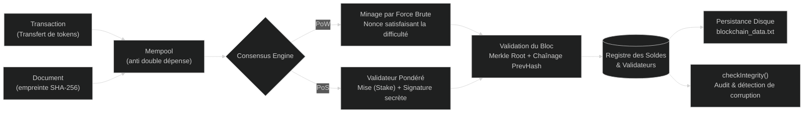

# ⛓️ Blockchain-Core-CPP

[](https://isocpp.org/)
[](https://opensource.org/licenses/MIT)
[]()
[]()
[](index.html)

A lightweight, high-performance, standalone blockchain implementation in modern **C++ (from scratch)** without any external dependencies.

This project implements the foundational cryptographic and distributed ledger primitives of modern blockchains, including **SHA-256**, **Merkle Trees**, **Proof of Work (PoW)**, **Proof of Stake (PoS)**, an interactive **Command Line Interface (CLI)**, **document notarization**, and **automatic disk persistence**.

---

## 🎨 Visual Summary & Infographic

<p align="center">
  
</p>

<p align="center">
  <a href="https://homam-dany.github.io/Blockchain-Core-CPP/">
    
  </a>
  <a href="index.html">
    
  </a>
</p>

> 💡 **Simulateur Interactif inclus** : Vous pouvez ouvrir directement [`index.html`](index.html) dans n'importe quel navigateur pour tester interactivement les cyberattaques sur les blocs, la simulation de rupture de chaîne et la comparaison en temps réel entre PoW et PoS !

---

## 🏗️ Architecture & Flux d'Exécution



---

## 🌟 Composants Clés de l'Application

### 1. 🔐 Fondation Cryptographique (From Scratch)
- **Moteur SHA-256 natif** : Implémenté de zéro en C++ sans OpenSSL. Traitement par blocs de 512 bits, 64 constantes $K$, fonctions de compression non linéaires et sortie de 256 bits irréversible.
- **Arbre de Merkle hiérarchique** : Hachage récursif par paires des transactions jusqu'à la `Merkle Root`. Toute altération d'une transaction modifie la racine instantanément.
- **Anatomie complète d'un bloc** :
  - `Index`, `Timestamp`, `PrevHash` (lien cryptographique avec le bloc précédent).
  - `MerkleRoot`, `Nonce` (PoW), `Validator` & `Signature` (PoS), `Hash`.
  - **Bloc Genesis (#0)** : Ancre de confiance immuable générée à l'initialisation.

---

### 2. ⚡ Double Moteur de Consensus : PoW vs PoS

| Métrique | Proof of Work (PoW) ⛏️ | Proof of Stake (PoS) ◈ |
| :--- | :--- | :--- |
| **Principe** | Recherche par force brute d'un `Nonce` | Sélection pseudo-aléatoire pondérée par la mise (`Stake`) |
| **Condition de validation** | Hash débutant par des zéros cibles (ex: `000...`) | Signature valide avec la clé secrète du validateur tiré |
| **Coût de calcul** | Élevé (charge processeur intensive) | Quasi nul (instantané) |
| **Temps de bloc** | Dépend de la difficulté (mesuré en millisecondes) | Immédiat (~0.04 ms) + récompense (+1 token de mise) |
| **Sécurité** | Puissance de calcul globale (CPU/ASIC) | Enjeu économique (séquestre des jetons / slashing) |

---

### 3. 🛡️ Audit de Sécurité & Détection des Cyberattaques

L'algorithme d'audit `checkIntegrity()` inspecte chaque bloc de la chaîne et identifie précisément la cause et le numéro du bloc fautif en cas d'attaque :

1. **Transaction modifiée** : Invalidation immédiate car la racine de Merkle recalculée $\neq$ `merkleRoot` stockée.
2. **Rupture de chaînage** : Détection dès que `prevHash` $\neq$ `hash` du bloc précédent.
3. **Altération d'en-tête (Header)** : Le hash du bloc ne correspond plus à `SHA256(headerData)`.
4. **Falsification de difficulté PoW** : Rejet si le hash ne respecte pas le nombre de zéros exigé.

---

### 4. 📜 Fonctionnalités Métier
- **Registre de comptes et anti-double dépense** : Validation stricte des soldes en déduisant les transactions en attente dans la `Mempool`.
- **Certification & Horodatage de documents** : Calcul de l'empreinte SHA-256 d'un texte, contrat ou diplôme avec association au propriétaire, garantissant l'antériorité sans divulguer le contenu brut.
- **Sauvegarde et restauration automatique** : Sauvegarde continue de la chaîne et des soldes dans `blockchain_data.txt`.

---

## 🚀 Prise en Main Rapide

### 📋 Prérequis
- Un compilateur C++ compatible C++11 ou supérieur (`g++`, `clang++`, ou `MSVC`).

### 🔨 Compilation
```bash
# Cloner le dépôt
git clone https://github.com/Homam-Dany/Blockchain-Core-CPP.git
cd Blockchain-Core-CPP

# Compiler avec optimisations
g++ -std=c++17 -O2 main.cpp -o blockchain_core.exe
```

### ▶️ Lancement
```bash
# Sur Windows
.\blockchain_core.exe

# Sur Linux / macOS
./blockchain_core
```

---

## 🎮 Menu Interactif en Console (CLI)

```text
================================================================
        BIENVENUE DANS VOTRE LOGICIEL BLOCKCHAIN (C++)          
================================================================
------------------------- MENU PRINCIPAL -------------------------
  1. [Transaction]   Envoyer des tokens (ex: Homam -> Houssam)
  2. [Certification] Horodater et certifier un document / texte
  3. [Minage]        Valider les transactions en attente (PoW ou PoS)
  4. [Comptes]       Voir les soldes et validateurs
  5. [Historique]    Afficher tous les blocs de la blockchain
  6. [Securite]      Verifier l'integrite de la blockchain
  7. [Compte]        Creer un nouvel utilisateur
  8. [Sauvegarder]   Enregistrer la blockchain dans un fichier
  9. [Recharger]     Recharger la blockchain depuis le fichier
  0. [Quitter]       Sauvegarder et quitter le programme
------------------------------------------------------------------
```
